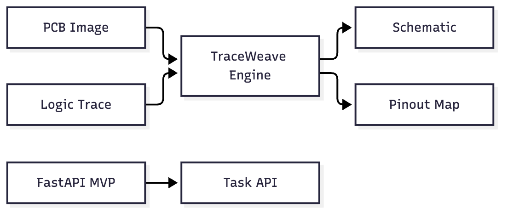
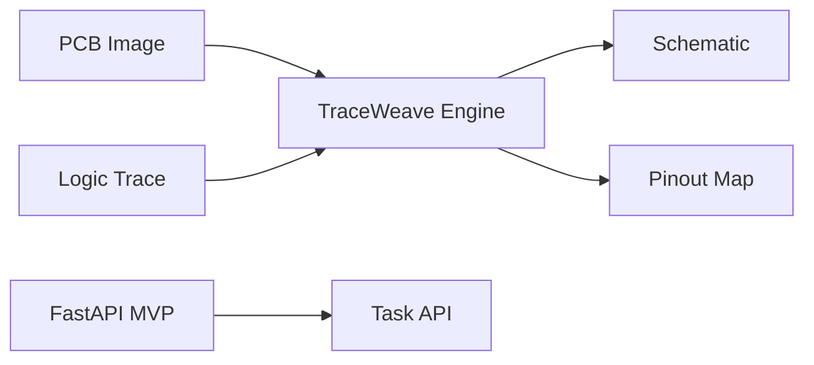

# TraceWeave

Generate accurate schematics and pinout maps from PCB images and logic traces.

# Task MVP

A simple task management API.

## Usage

Run server:
uvicorn main:app --reload

Test:
pytest -q

## Architecture

Mermaid source

